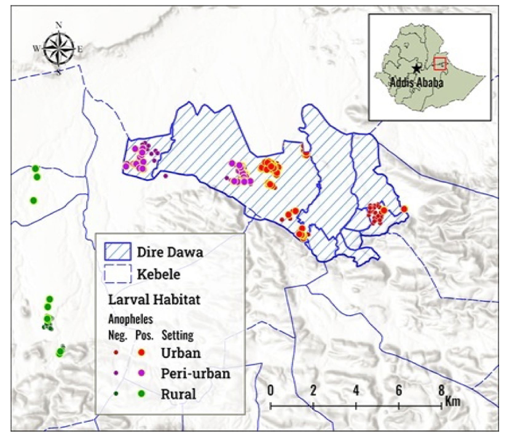
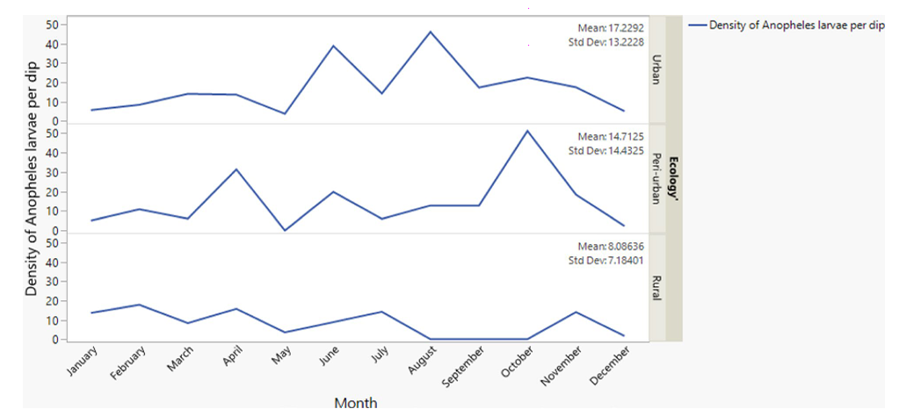
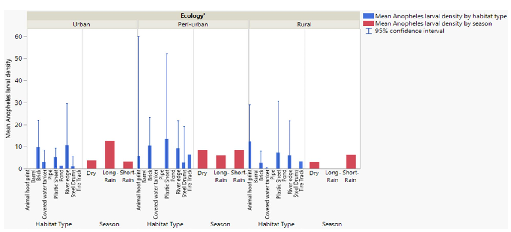
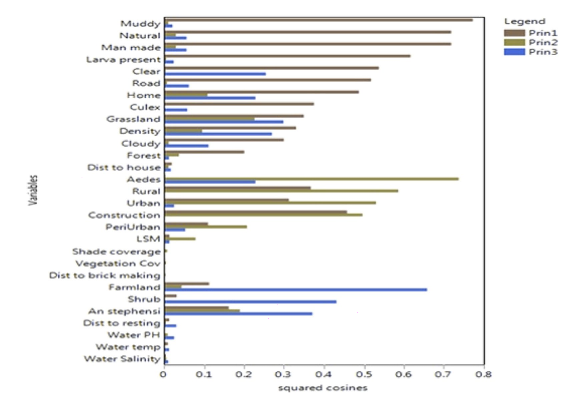
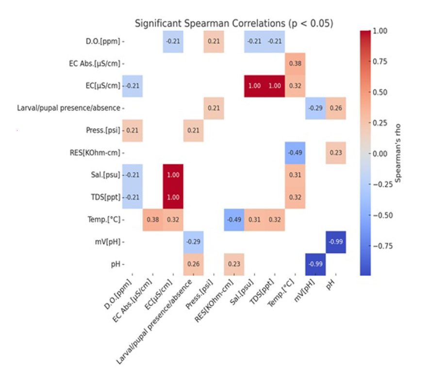
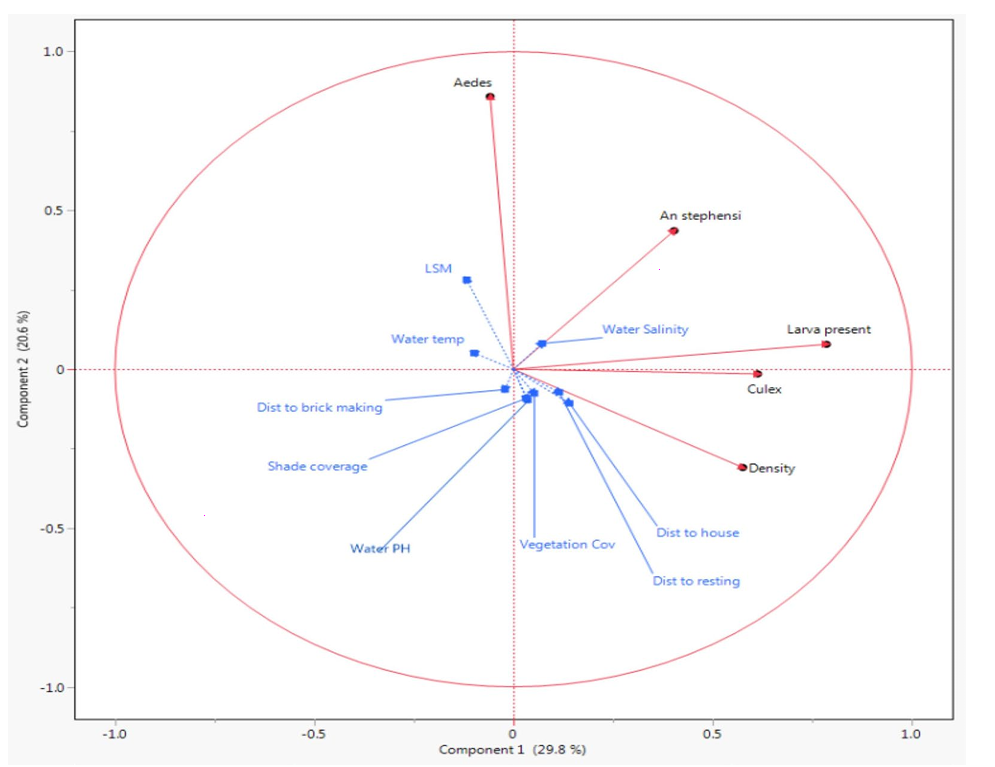

# 🦟 Anopheles Larval Ecology in Dire Dawa, Ethiopia

[](https://doi.org/10.21203/rs.3.rs-8442371/v1)
[](https://doi.org/10.1186/s12936-026-06082-w)
[](https://creativecommons.org/licenses/by/4.0/)

> Note: This repository primarily hosts the preprint version of the manuscript. The final peer-reviewed Version of Record was published in Malaria Journal on August 1st, 2026.

 📖 Study Overview

Understanding mosquito larval ecology is crucial for effective vector control. This 16-month longitudinal study (February 2023 – December 2024) characterized Anopheles larval habitats across urban, peri-urban, and rural settings in Dire Dawa City Administration, Eastern Ethiopia. 


## Key Findings:

*  🏙️ Dominance: The invasive Anopheles stephensi was the most predominant species, accounting for 75% (2,194/2,934) of emerged adults.
*  🌍 Rural Expansion: An. stephensi was found breeding in rural areas and natural habitats (river edges), co-existing with An. arabiensis and An. amharicus.
*  🧱 Habitat Preference: Uncovered brick/concrete water tankers and plastic sheets were the most prolific artificial habitats.
*  💧 Water Chemistry: Larval presence was positively correlated with water pH and water pressure, though most habitats were predominantly freshwater.
*  🚨 Intervention Gap: Larval presence was not associated with the presence of larviciding interventions, highlighting an urgent need for improved larval source management (LSM) strategies.


 ## 📂 Repository Structure

```text
├── 📁 Published_Papers/
│   ├── 📄 Pre-print_Anopheles_Larval_Ecology.pdf
│   └── 📄 Final_Article_Malaria_Journal.pdf
│
├── 📁 Datasets/
│   ├── 📊 Habitat_type_Season_and_Ecology.xlsx
│   └── 📊 Monthly_density_Vs_ecology.xlsx
│
├── 📁 Tables_Figures/
│   ├── 🖼️ fig_1_study_area_map.png
│   ├── 🖼️ fig_2_habitat_types.png
│   ├── 🖼️ fig_3_monthly_density.png
│   ├── 🖼️ fig_4_seasonal_density.png
│   ├── 🖼️ fig_5_pca_squared_cosines.png
│   ├── 🖼️ fig_6_spearman_correlation.png
│   └── 🖼️ fig_7_pca_biplot.png
│
└── 📝 README.md
```


 ## 📊 Key Visualizations


Click on the dropdown menus below to expand and view the key figures from the study.

<br>

<details>
<summary><b>🗺️ Figure 1: Map of the Study Area</b></summary>
<br>
<p align="justify">
<i>Map of the study area in Dire Dawa City Administration (2024), illustrating the distinct urban, peri-urban, and rural ecological settings surveyed. The map details the distribution of positive and negative larval habitats.</i>
</p>



</details>

<br>

<details>
<summary><b>📈 Figure 3: Monthly Larval Density by Ecology</b></summary>
<br>
<p align="justify">
<i>Mean Anopheles larval density by month and ecological setting. The data demonstrate that larval density fluctuates seasonally, but remains consistently higher in peri-urban and urban settings compared to rural areas.</i>
</p>



</details>

<br>

<details>
<summary><b>📊 Figure 4: Larval Density by Season and Habitat</b></summary>
<br>
<p align="justify">
<i>Mean Anopheles larval density broken down by season (Dry, Long-Rain, Short-Rain), specific habitat type, and ecological setting. Brick cisterns in peri-urban areas show the highest peak densities.</i>
</p>



</details>

<br>

<details>
<summary><b>📉 Figure 5: PCA Squared Cosines</b></summary>
<br>
<p align="justify">
<i>Variables grouped by Principal Component Analysis (PCA). Variables grouped together indicate correlation. Principal Component 1 (brown) includes Anopheles and Culex larval presence, PC2 (green) includes Aedes larval density, and PC3 (blue) includes An. stephensi presence.</i>
</p>



</details>

<br>

<details>
<summary><b>🌡️ Figure 6: Spearman Correlations</b></summary>
<br>
<p align="justify">
<i>Heatmap showing significant Spearman correlations (p < 0.05) among water physicochemical parameters (e.g., temperature, pH, TDS, salinity) and larval presence/absence.</i>
</p>



</details>

<br>

<details>
<summary><b>🔍 Figure 7: PCA Biplot</b></summary>
<br>
<p align="justify">
<i>PCA correlation biplot showing the relationship between environmental/physicochemical parameters and the presence/density of mosquito immatures. Note the positive correlation of An. stephensi with water salinity and pH.</i>
</p>



</details>


 ## 👥 Authors & Affiliations

   Ephrem Abiy (Jimma University)
   Teshome Degefa (Jimma University)
   Meshesha Balkew (Former staff of Abt Global)
   Hailu Merga (Jimma University)
   Deneke Zewdu (Jimma University / TIDRC) <-- You!
   Alamayo Ayala (Jimma University)
   Harrysone Atieli (University of California at Irvine)
   Ming-Chieh Lee (University of California at Irvine)
   Guofa Zhou (University of California at Irvine)
   Guiyun Yan (University of California at Irvine)
   Delenasaw Yewhalaw (Jimma University)

   

 ## 📜 Citation

## Pre-print:
> Abiy E, Degefa T, Balkew M, Merga H, Zewdu D, Ayala A, Atieli H, Lee MC, Zhou G, Yan G, Yewhalaw D. Anopheles larval ecology and physicochemical characterization of larval habitats in Dire Dawa: an area colonized by Anopheles stephensi in Eastern Ethiopia [Preprint]. Research Square. 2026. DOI: 10.21203/rs.3.rs-8442371/v1


## Published Version:
> Abiy E, Degefa T, Balkew M, Merga H, Zewdu D, Ayala A, Atieli H, Lee MC, Zhou G, Yan G, Yewhalaw D. Anopheles larval ecology and physicochemical characterization of larval habitats in Dire Dawa: an area colonized by Anopheles stephensi in Eastern Ethiopia. Malar J. 2026; 1:100008.
